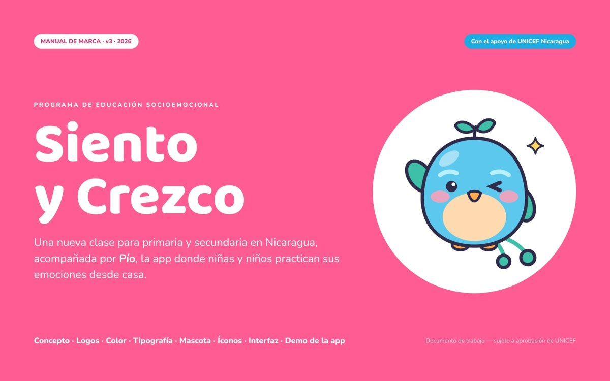
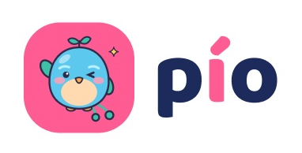
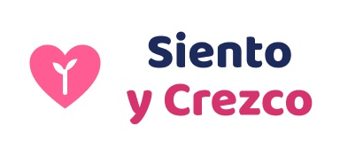
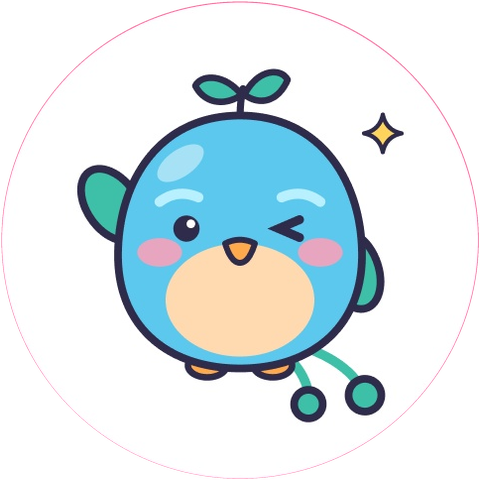
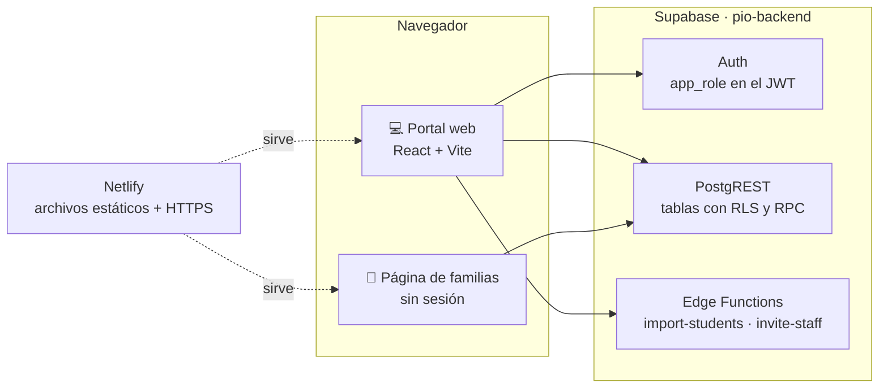

<div align="center">



<br />
<br />


&nbsp;&nbsp;&nbsp;&nbsp;


<h1>pio-web</h1>

<p><b>Portal web de Pío</b> para docentes, orientación y dirección, más la página de las familias.<br />
<i>Saber cómo está el grupo, asignar la lección de la semana y acompañar a quien lo necesita.</i></p>

<p>
  <a href="https://github.com/daamaleman/pio-web/actions/workflows/ci.yml"></a>
  <a href="https://pio-portal.netlify.app"></a>
  
  
  
  
</p>

<p>
  <a href="#-qué-es">Qué es</a> ·
  <a href="#-pantallas">Pantallas</a> ·
  <a href="#-arquitectura">Arquitectura</a> ·
  <a href="#-inicio-rápido">Inicio rápido</a> ·
  <a href="#-diseño">Diseño</a> ·
  <a href="#-seguridad-y-privacidad">Privacidad</a> ·
  <a href="#-despliegue">Despliegue</a> ·
  <a href="#-estado-del-mvp">Estado</a>
</p>

</div>

<br />

## 💗 Qué es



**Siento y Crezco** es una clase semanal de educación socioemocional para primaria y secundaria en Nicaragua. La acompaña **Pío**, un guardabarranco que guía a los estudiantes en la app móvil.

Este repositorio es el **portal web** del personal de la escuela:

- **La docente** ve cómo se siente su grupo, asigna la lección de la semana, sigue el avance por indicador (sin notas) y recibe alertas de quién podría necesitar una conversación.
- **Orientación y dirección** ven la escuela en números, atienden las alertas que les corresponden y suman al personal.
- **Las familias** abren por QR una página con el reto en casa, sin cuenta y sin dejar datos.

Funciona en el celular de la docente (con la barra inferior del diseño en Figma) y en computadora (con barra lateral). Todo se conecta al API de [`pio-backend`](https://github.com/daamaleman/pio-backend), que es donde viven los datos, los permisos y las reglas de privacidad.

<br clear="right" />

## 🧭 Pantallas

<table>
  <tr>
    <td width="33%" valign="top">
      <h3>👩‍🏫 Docente</h3>
      <b>Panel</b>: clima del grupo, aviso de apoyo y tareas activas.<br />
      <b>Lecciones</b>: biblioteca con filtros por emoción y lección sugerida.<br />
      <b>Asignar</b> en 3 toques: a quién, hasta cuándo y un mensaje.<br />
      <b>Progreso</b>: quién terminó, indicadores y "Recordar a los pendientes".<br />
      <b>Plan del mes</b> según el día de clase.
    </td>
    <td width="33%" valign="top">
      <h3>👥 Grupos</h3>
      Crear y editar grupos, código de clase.<br />
      <b>Estudiantes</b>: importar desde Excel con vista previa, nuevo PIN y tarjetas imprimibles.<br />
      <b>Familias</b>: permisos, fichas semanales y registro de la ficha en papel.<br />
      <b>Bienestar</b>: autoevaluación del mes y encuestas anónimas.
    </td>
    <td width="33%" valign="top">
      <h3>🏫 Escuela</h3>
      <b>Mi escuela</b>: totales, clima y avance por grupo, solo con números.<br />
      <b>Alertas</b>: las de riesgo primero, sin el contenido del chat.<br />
      <b>Personal</b>: equipo de la escuela e invitaciones por correo.<br />
      Activar el chat de IA por grupo (dirección).
    </td>
  </tr>
  <tr>
    <td valign="top">
      <h3>🔔 Alertas</h3>
      Motivo en palabras simples, nunca un diagnóstico. Estados: nueva → en atención → cerrada. Cada rol ve lo que la base le permite.
    </td>
    <td valign="top">
      <h3>🏡 Familias (público)</h3>
      Página por QR con la lección de la semana, el reto en casa, la nota para la familia y consejos para acompañar. En español e inglés.
    </td>
    <td valign="top">
      <h3>🔑 Cuenta</h3>
      Login con correo, aceptar invitación, olvidé mi contraseña y perfil.
    </td>
  </tr>
</table>

<details>
<summary><b>🗺️ Rutas</b></summary>

<br />

| Ruta | Quién | Qué muestra |
|---|---|---|
| `/login` · `/olvide` · `/restablecer` · `/aceptar-invitacion` | Público | Entrar, recuperar contraseña y crear la contraseña de una invitación |
| `/familia/:token` | Público (QR) | Página semanal de la familia |
| `/docente` | Docente | Panel del grupo |
| `/docente/lecciones` · `/docente/lecciones/:lessonId/asignar` · `/docente/plan` | Docente | Biblioteca, asignar y plan del mes |
| `/docente/asignaciones/:id` | Docente | Progreso de una tarea |
| `/docente/alertas` | Docente | Alertas de sus grupos |
| `/docente/grupos` · `…/nuevo` · `…/:groupId/editar` | Docente | Grupos |
| `/docente/grupos/:groupId/estudiantes` · `…/agregar` | Docente | Estudiantes, PIN e importación |
| `/docente/grupos/:groupId/qr` · `…/familias` | Docente | QR imprimible y familias |
| `/bienestar/:groupId` | Docente, dirección, orientación | Autoevaluación y encuestas del grupo |
| `/escuela` · `/escuela/alertas` | Dirección, orientación | Panel y alertas de la escuela |
| `/escuela/personal` | Dirección | Personal e invitaciones |
| `/admin` | Admin | Administración (en construcción) |
| `/yo` | Todo el personal | Perfil y cerrar sesión |

</details>

## 🏗️ Arquitectura



**El portal no tiene servidor propio.** Netlify solo entrega los archivos. El navegador habla directo con Supabase usando la **publishable key** (pública) y la sesión de cada persona. Qué filas ve cada uno lo decide la **RLS de Postgres**, no la pantalla: si el portal tuviera un error, igual no podría mostrar datos que la base no permite.

<table>
  <tr><th align="left">Capa</th><th align="left">Tecnología</th></tr>
  <tr><td>Interfaz</td><td>React · TypeScript · Vite · React Router</td></tr>
  <tr><td>Datos</td><td><code>@supabase/supabase-js</code> · TanStack Query · tipos generados desde la base</td></tr>
  <tr><td>Estilos</td><td>Tailwind CSS v4 con los tokens de la marca · Lucide (íconos) · Fontsource (Baloo 2 y Nunito, sin Google Fonts)</td></tr>
  <tr><td>Archivos en el navegador</td><td>SheetJS (leer Excel) · <code>qrcode</code> (QR de familias), cargados solo cuando se usan</td></tr>
  <tr><td>Despliegue y CI</td><td>Netlify · GitHub Actions (lint + typecheck + build)</td></tr>
</table>

## 📁 Estructura

```text
pio-web/
├─ public/
│  ├─ _redirects               # SPA: every path serves index.html
│  ├─ logo-pio.png
│  └─ pio-mascota.png
├─ src/
│  ├─ app/                     # router, AuthProvider, guards, query client
│  ├─ components/
│  │  ├─ layout/               # AppShell (sidebar + bottom bar), PageHeader
│  │  ├─ ui/                   # Card, ErrorCard, Toggle
│  │  └─ EmotionDrop, ClimateCard, GroupSelect
│  ├─ features/
│  │  ├─ auth/                 # login, set password, forgot password, profile
│  │  ├─ teacher/              # panel, library, assign, progress, plan, groups, QR, families
│  │  ├─ students/             # list, PIN reset, import, PIN cards
│  │  ├─ alerts/               # shared alerts screen
│  │  ├─ school/               # school panel, staff, AI chat toggle
│  │  ├─ wellbeing/            # self-assessment and polls
│  │  └─ family/               # public family page
│  ├─ lib/
│  │  ├─ supabase.ts           # the only Supabase client
│  │  ├─ database.types.ts     # generated: npm run gen:types
│  │  ├─ roles.ts · claims.ts  # roles and JWT claims (UI only)
│  │  ├─ format.ts · classDates.ts · emotions.ts
│  ├─ index.css                # Tailwind + brand tokens (@theme)
│  └─ main.tsx
├─ netlify.toml                # build + security headers
└─ .github/workflows/ci.yml
```

## 🚀 Inicio rápido

**Requisitos:** [Node.js](https://nodejs.org/) 20 o superior, y acceso al proyecto de Supabase (staging) o el backend corriendo en local.

```bash
git clone https://github.com/daamaleman/pio-web.git
cd pio-web
npm install
cp .env.example .env.local     # then fill in the values (see below)
npm run gen:types              # types from the staging database
npm run dev                    # http://localhost:5173
```

| Variable | Qué es |
|---|---|
| `VITE_SUPABASE_URL` | URL del proyecto de Supabase (staging o `http://127.0.0.1:54321` en local) |
| `VITE_SUPABASE_PUBLISHABLE_KEY` | Clave **pública** del proyecto. Nunca la secret key: todo lo `VITE_*` termina en el navegador |
| `VITE_ENV_NAME` | Etiqueta del entorno que se ve en la interfaz (`staging`, `local`) |
| `VITE_PUBLIC_URL` | Opcional. URL pública del portal para el QR de familias; vacío = la dirección actual |

| Script | Qué hace |
|---|---|
| `npm run dev` | Servidor de desarrollo. Con `-- --host` se abre desde el celular en la misma red, para probar el QR |
| `npm run build` | Revisa los tipos (`tsc -b`) y genera `dist/` |
| `npm run lint` | ESLint |
| `npm run gen:types` | Regenera `src/lib/database.types.ts` desde staging. En Windows usar este script y no `>` de PowerShell (guarda en UTF-16) |

<details>
<summary><b>👥 Usuarios de demo</b></summary>

<br />

Los usuarios, contraseñas y PIN de demo están en el README de [`pio-backend`](https://github.com/daamaleman/pio-backend#-inicio-rápido). Solo existen en local y staging.

| Rol | Usuario | Entra a |
|---|---|---|
| Docente | `ana.lopez@demo.pio` | `/docente` |
| Dirección | `rosa.gutierrez@demo.pio` | `/escuela` (con Personal) |
| Orientación | `marta.solis@demo.pio` | `/escuela` |
| Admin | `admin@demo.pio` | `/admin` |

</details>

### Flujo de trabajo con el backend

Cuando una pantalla necesita algo nuevo en la base:

1. En **`pio-backend`**: migración nueva → `npx supabase migration up` → `npx supabase test db` → `npx supabase db push --remote`.
2. En **`pio-web`**: `npm run gen:types` → **`npm run build`** → commit → push.

Si una columna o función no existe en la base, `npm run build` falla y dice cuál. Así los errores aparecen en tu compu, no en Netlify ni frente a una docente.

Commits en inglés con [Conventional Commits](https://www.conventionalcommits.org/): `feat(web): …`, `fix(web): …`, `perf(web): …`.

## 🎨 Diseño

El portal sigue el **Manual de Marca de Siento y Crezco** y las pantallas del docente del Figma (Panel, Biblioteca, Asignar y Progreso). Las pantallas que no tienen diseño se arman con los mismos componentes.

| Token | Color | Uso |
|---|---|---|
| `azul` | `#374EA2` | Modo docente: botones, menú activo, encabezados |
| `rosa` · `rosa-profundo` · `rosa-suave` | `#FF5C93` · `#D6336C` · `#FFE3EE` | Familias y estudiantes, lo sugerido, avisos importantes |
| `cian` | `#1CABE2` | Encuestas y avatares |
| `tinta` | `#1D2A5C` | Texto |
| `arena` · `linea` | `#F7F5F2` · `#ECE7E1` | Fondo y bordes |
| `alegria` · `tristeza` · `enojo` · `miedo` · `calma` · `carino` | `#FFC20E` · `#8FD6F2` · `#FF8A80` · `#C9A3D1` · `#B8DC8E` · `#FF9EBF` | Gotas de emoción |

**Tipografía:** Baloo 2 en títulos y botones, y Nunito en el texto, servidas desde el propio sitio. **Estilo:** plano, cálido y sin castigo, con botones de píldora, tarjetas redondeadas y nada de notas, rankings ni rojo de error para los estudiantes.

## 🛡️ Seguridad y privacidad

| Decisión | Por qué |
|---|---|
| Solo la publishable key en el portal; los secretos viven en Supabase | Todo lo que va en el JavaScript lo puede ver cualquiera |
| La RLS decide qué datos llegan; el rol del JWT solo elige el menú | Cambiar el token en el navegador no da acceso a nada |
| Clima, encuestas y autoevaluación siempre agregados y ocultos con menos de 3 respuestas | Nadie queda identificado por sus respuestas |
| El aviso de apoyo del Panel no muestra nombres; los nombres aparecen solo en Alertas | Solo los ve quien tiene que actuar |
| Las alertas del chat de IA muestran la categoría, nunca la conversación | Nadie lee lo que un adolescente escribe a Pío |
| El PIN nuevo se muestra una sola vez | La base lo guarda cifrado y no se puede volver a leer |
| El Excel y el QR se procesan en el navegador | El archivo de la lista y el enlace del grupo no pasan por servicios externos |
| Mensajes que no revelan si un correo existe | En el login y en "olvidé mi contraseña" |
| `Referrer-Policy: no-referrer` y `X-Frame-Options: DENY` | La página de familias lleva el token del grupo en la URL; nadie puede meter el portal en otra página |
| Caché de datos borrada al cerrar sesión; en el navegador solo se guarda el último grupo elegido | Computadoras compartidas en la escuela |
| La página de familias no pide ni guarda datos | Sin teléfonos, correos ni nombres de las familias |

## ☁️ Despliegue

| Entorno | Dónde | API |
|---|---|---|
| Desarrollo | `http://localhost:5173` | Staging o Supabase local |
| **Staging** | [pio-portal.netlify.app](https://pio-portal.netlify.app) | Supabase staging |
| Producción | Pendiente: VPS de Namecheap con Docker y Nginx, o Netlify con dominio propio | Supabase producción |

Netlify publica solo **cada push a `main`**. La configuración está en el repo:

- `netlify.toml`: `npm run build`, carpeta `dist`, Node 22, cabeceras de seguridad y caché de un año para `/assets/*`.
- `public/_redirects`: toda ruta sirve `index.html`, para que recargar `/docente/lecciones` o abrir un QR no dé 404.
- Variables en Netlify: `VITE_SUPABASE_URL`, `VITE_SUPABASE_PUBLISHABLE_KEY` y `VITE_ENV_NAME`. Se leen **al compilar**: cualquier cambio necesita un deploy nuevo.

> [!IMPORTANT]
> En Supabase → **Authentication → URL Configuration**, el *Site URL* y las *Redirect URLs* deben incluir el dominio del portal (`https://pio-portal.netlify.app/**`) y `http://localhost:5173/**`. Si no, los enlaces de invitación y de recuperación de contraseña no llegan al portal. El secreto `STAFF_INVITE_REDIRECT_URL` de las Edge Functions apunta a `/aceptar-invitacion`.

## ✅ Estado del MVP

- [x] Login, roles y menú adaptado a celular y computadora
- [x] Panel, Biblioteca, Asignar y Progreso (las pantallas del Figma)
- [x] Alertas para docente, orientación y dirección
- [x] Estudiantes: Excel, PIN y tarjetas
- [x] Grupos, QR y página de familias
- [x] Panel de escuela, personal, invitaciones y contraseñas
- [x] Familias: permisos, fichas y ficha en papel
- [x] Bienestar: autoevaluación y encuestas
- [x] Plan del mes
- [ ] Reportes de cierre de mes en Excel y PDF
- [ ] Observaciones del docente por estudiante
- [ ] Buzón de preguntas anónimas (secundaria)
- [ ] Administración básica: escuelas y catálogo
- [ ] Guía del docente por lección y materiales imprimibles
- [ ] Portal en inglés para Bluefields
- [ ] Correos con diseño de Pío en la nube (necesita SMTP propio)

## 👥 Equipo

<table>
  <tr>
    <td align="center"><b>Diedereich</b><br /><sub>Líder del equipo · Backend y portal web</sub></td>
    <td align="center"><b>José</b><br /><sub>App móvil</sub></td>
    <td align="center"><b>Sofía</b><br /><sub>Chat de IA "Pío te escucha"</sub></td>
    <td align="center"><b>Margie</b><br /><sub>Contenido de las lecciones</sub></td>
  </tr>
</table>

<br />

<div align="center">


<br />
<br />

<b>Siento y Crezco</b> · Con el apoyo de UNICEF Nicaragua · Universidad Americana (UAM)<br />
<sub>Documento de trabajo, sujeto a aprobación de UNICEF. Las marcas y la mascota Pío pertenecen al proyecto Siento y Crezco.</sub>

</div>
